# TeamEasy build guide

**Who this is for:** the three engineers building the production app. It describes what the finished app looks like and how it behaves, screen by screen, in plain language, and breaks every part into build phases. It contains no code.

**What it is based on:** a working reference prototype (a phone app, built as a web app, running on fake data) that the designer finished and signed off. Every screenshot in this guide was taken from that prototype. The prototype is the visual and behavioural reference; the production app should look and behave the same way.

**Contents:** 1 The product in one page · 2 Design system · 3 How the app is laid out · 4 The parts, in phases (A Accounts, B Chat list and search, C Conversation, D Groups and teams, E Calendar, F Notifications, G Calls, H Account and data, I Plan and ads, J Platform) · 5 Motion · 6 States · 7 Overall build order · 8 Open questions · 9 Acceptance checklist

**Where the rest lives** (all in the `docs` folder of the repository):

| File | What it adds |
|---|---|
| `PRD.md` | The agreed scope, with an ID for every requirement (for example `CHT-05`). IDs are used here, in commits and in QA. |
| `DESIGN.md` | Design decisions per area, and the motion durations table. |
| `MOTION_PLAN.md` | How each motion was decided and built. |
| `WIRING.md` | The list of every placeholder in the prototype that must become real, with what the real version must do. |
| `HANDOVER.md` | Short technical handover: where things live in the prototype, how to run it. |

**How to run the reference prototype:** it is a normal web project. `npm install`, `npm run dev`, then open the address it prints on a phone (or a browser window narrowed to phone width). Sign in with `layla@acme.co` and the password `longpass1`. To see the fake-state switcher (empty, error, slow, offline and so on) open any page once with `?review` added to the address, for example `/chats?review`.

> **One open decision that gates everything:** which client framework the production app uses. The prototype is a web app (React). An earlier Flutter attempt exists on the `flutter-archive` branch, and the engineers' own repo may use Flutter. This guide does not depend on the choice: it describes behaviour, not implementation. Settle the framework before Phase 1.

---

## 1. The product in one page

TeamEasy is a team messaging app. People use it on their phones for chats, calls, media and a calendar. People can use it on their own or as part of an organization.

| Who | What they do | Where |
|---|---|---|
| Individual | Signs up on their own, no organization needed | Phone app |
| Organization member | Joins an organization through an admin's invite, and can still use the app on their own | Phone app |
| Admin | Runs their organization's groups, invites, calendars and plan, from the same app | Phone app |

**What the app is made of** (the "parts" this guide builds in phases):

| Part | In one line |
|---|---|
| A. Accounts and onboarding | Sign up in three ways, sign in, invites, switching identity, deleting an account |
| B. Chat list and search | The home screen: your chats, filters, search, actions on a chat |
| C. Conversation | Messages, photos and documents, message actions, contact info |
| D. Groups and teams | A tree of groups and sub-groups, roles, invites by link, leaving, deleting, archiving |
| E. Calendar | A shared calendar that admins assign to people |
| F. Notifications and updates | In-app banner, what's new, push, notification settings |
| G. Calls | Audio and video calls with a daily time cap |
| H. Account, profile and data | Profile editing, media download setting, retention rules, backup and transfer |
| I. Plan, ads and purchases | Free plan with ads, paid add-ons, restore purchases |
| J. Platform | Install to home screen, permissions, native feel, offline, device integrations |

### The numbers that shape the product

These are product rules. The server must enforce every one of them; the app only warns early. They must come from configuration, never be typed into screens.

| Rule | Value | Notes |
|---|---|---|
| Members per main group | 300 | Counted across the main group and all its sub-groups together. Admins see how many places are left. Going past it is a paid add-on |
| Group depth | 5 groups, each with up to 5 sub-groups, each with up to 5 sub-sub-groups | Assumed to be per parent, not 5 in total per level |
| Groups one person can belong to | 12 | Assumed; the PRD gives no number |
| Group call size | 5 people including you | |
| Calling time | 1 hour per person per day, shared by audio and video | Resets at midnight local time (assumed) |
| Attachment size | 25 MB | Assumed |
| Unopened attachments are deleted after | 6 days (standard) or 15 days (business) | A "deleted soon" note shows with 3 days left |
| Archived groups are deleted after | 90 days | Assumed; a database value in production |
| Undo after deleting a group | 8 seconds | Assumed; a database value in production |
| Phone transfer code lasts | 10 minutes, single use | |
| Password | 8+ characters, a letter and a number | Assumed |

---

## 2. Design system

Everything on screen is built from one small set of values. Use these names and values, not new ones.

### Look and feel in a sentence

It feels like the messaging apps people already know (WhatsApp's layout), drawn with our own colors, Poppins type, solid-blue accents, and iPhone-style motion. Light theme only. English only, no right-to-left for now. Calm in settings, dense in chat.

### Color

| Role | Value | Used for |
|---|---|---|
| Primary (brand blue) | `#1F62A3` | Main buttons, unread times, links, selected states |
| Accent | `#2BACE2` | The T logo and light highlights |
| Navy text | `#0D142E` | All main text |
| Secondary text | `#4B5675` | Previews, captions |
| Disabled text | `#98A2B8` | Disabled controls |
| Highlight (pale yellow) | `#F6F3DD` | Announcements card and ads |
| Page background | `#F7FAFD` | App background |
| White | `#FFFFFF` | Cards, rows, incoming bubbles |
| Soft blue surfaces | `#F1F5FA`, `#E9EFF6`, `#E3E9F1`, `#DCE3EC` | Fields, chips, quiet areas (lightest to darkest) |
| Primary tint | `#D3E4F7` | Selected tab, chip, outgoing accents |
| Outgoing bubble | `#CFE3F8` | Your messages |
| Conversation wallpaper | `#E6EDF5` with a faint pattern | Behind messages |
| Success | `#1E8E5A` (tint `#D5EFE2`) | Online, saved, done |
| Warning | `#B7791F` (tint `#FBEBCB`) | Away, limits close |
| Error | `#C0392B` (tint `#FBE1DD`) | Errors, failed message, destructive |
| Lines | `#C9D3E1` | Hairlines and outlines |

Sender names inside group chats use one color per person, picked from five: blue, teal, green, gold, purple. Avatars use five soft color pairs so people and groups are easy to tell apart. People without a photo show their initials.

### Type

One typeface: **Poppins** (400, 500, 600, 700). Sizes:

| Style | Size / line | Weight | Used for |
|---|---|---|---|
| Display | 32 / 40 | 600 | Welcome headline |
| Headline | 28 / 36 | 600 | Large page titles |
| Title | 22 / 28 | 600 | Section and sheet titles |
| Small title | 16 / 24 | 600 | Names, row titles |
| Body | 16 / 24 | 400 | Messages, fields |
| Small body | 14 / 20 | 400 | Previews, descriptions |
| Label | 14 / 20 | 500 | Chips, form labels |
| Caption | 12 / 16 | 400 | Times, hints |

### Spacing, shape, depth

- Spacing steps: 2, 4, 8, 12, 16, 20, 24, 32, 48 px. Screen side margin 16 px.
- Corner radius: 4, 8, 12, 16, 28 and fully round. Bubbles use 12. Sheets 28 on top. Buttons, chips, search and tab bar are fully round.
- Depth is mostly color, not shadow. Shadow only on floating things: the tab bar, sheets, menus, toasts.
- Touch targets: at least 48 px (44 pt on iPhone).

### Icons

Only the **Solar** icon set, Linear style (credit: 480 Design, CC BY 4.0). Never draw icons by hand. Icons carry a text label wherever the meaning is not obvious, and every icon-only button has an accessible name.

### The components every screen is made from

Button (primary, secondary, tertiary, destructive, with loading and disabled), text field (label, hint, inline error, show/hide password), search pill, avatar (with online dot, group, initials), unread badge, filter chip, segmented control, switch, banner (info, success, error, offline) with an action, bottom sheet (with a handle, optionally two heights), snackbar with Undo and a countdown, toast, skeleton placeholders, empty-state block (icon, title, one line, one action), list row, large page title that shrinks on scroll.

### Every screen ships all its states

A screen is not finished until it has: **loading** (skeleton rows, never a lone spinner), **empty** (says what is missing and offers the next step), **error** (what happened and a Try again button), **offline** (a banner that says so, with cached content still visible), **success**, and for messaging also **sending** and **failed** (red outline and "Not sent. Tap to retry"). Section 6 shows these.

### Accessibility

Contrast meets WCAG AA. Every control has an accessible name. Respect the system "Reduce motion" setting (Section 5). Text fields use 16 px so iPhone does not zoom. Dynamic type should not break layouts. Gestures always have a visible alternative (sheets close with a tap outside, the photo viewer has a Close button, chats have a Back button, swipe actions are also in the long-press sheet).

---

## 3. How the app is laid out

**On a phone** there are four tabs in a floating glass pill near the bottom: **Chats, Groups, Calendar, Account.** Tabs switch instantly. Opening a chat slides it in from the right over the list; the tab bar slides away while a chat is open. Account has sub-pages (edit profile, plan, calls, notifications, data, what's new) that slide in from the right.

This guide covers the **mobile app only**.

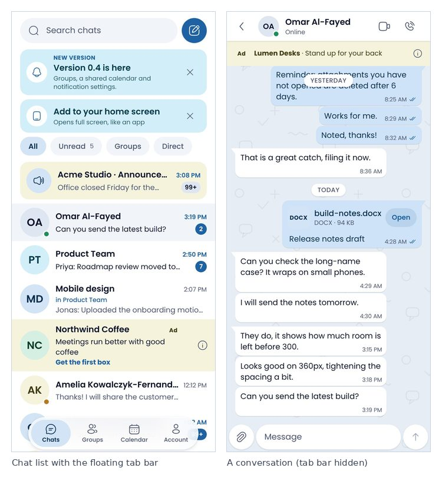

**Navigation rules**

- Only screens that exist appear in navigation.
- Pushed pages have a Back arrow at the top left. Chats can also be dismissed by swiping from the left edge.
- Opening a group from the Groups tab goes straight to its chat. The group's info page opens from the group's name in the chat's top bar, like WhatsApp.
- Signed-out people only see the Welcome, Sign up, Sign in, Forgot password, Invite and Join-link screens. Signed-in people opening those are sent home.

---

## 4. The parts, in phases

Each part below has: what the person sees and does, the rules, the screens, and **its own build phases** (A1, A2 and so on). Section 7 puts all of them in one overall order. A phase is done when its **exit check** passes.

> **Placeholders:** in the prototype, anything that needs a server, push service, payments, call service or device permission is faked on purpose. Every fake is listed in `WIRING.md` with what the real version must do. When a phase says "wire", it means replace that fake with the real thing without changing how the screen looks or behaves.

---

### Part A. Accounts and onboarding  (ACC-01 to ACC-08)

**What people do:** open the app, create an account in one of three ways, sign in, reset a password, accept an organization invite, switch between their personal and organization identity, or delete their account.

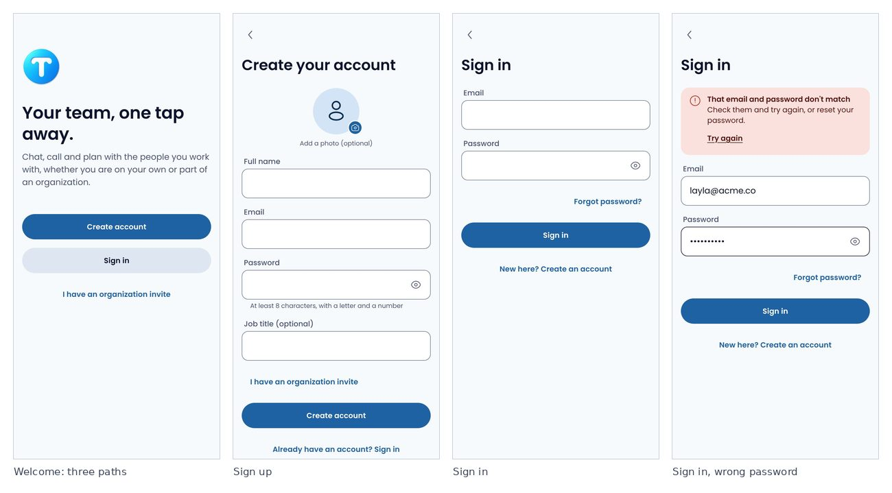

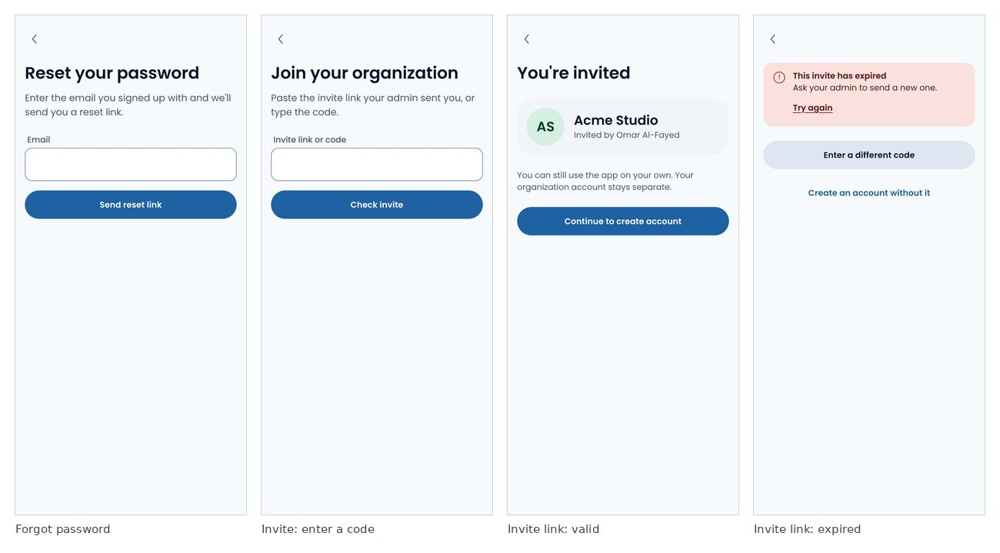

**Flows**

1. **Sign up as an individual (ACC-02):** Welcome, Create account, enter name, email, password, optional photo, optional job title, Create. Lands on Chats.
2. **Sign up and attach to an organization (ACC-03):** same form, with "I have an organization invite" expanded to enter a code. Joining always needs an admin-issued invite (ACC-05).
3. **Get invited (ACC-04):** an invite link opens a page that shows the organization and who invited the person, then continues to sign up with the organization already attached. An invalid, expired or offline invite each shows its own message with a way forward.
4. **Sign in:** email and password. A wrong password shows an inline error on the field and the form shakes once. Forgot password sends a reset email and says the same thing whether or not the address exists.
5. **Identity switch (ACC-07):** a "Chat as" choice on the Account screen: Myself or the organization. It separates the two identities' data. Joining an organization never stops someone using the app on their own (ACC-06).
6. **Delete account (ACC-08):** Account, Delete account. A confirmation sheet says what is lost. Confirming signs out and removes the data.

**Rules**

- Password: at least 8 characters, with a letter and a number (assumed). Show or hide toggle on the field.
- Buttons show a spinner while working and the form cannot be sent twice.
- Errors appear next to the field they belong to; network errors appear as a banner with Try again.
- A signed-in person opening an invite link is sent home. Existing users cannot yet accept an invite (open question).
- A join link opened while signed out is remembered: after signing in or up, the person lands on that join page.

**Phases**

| Phase | What gets built | Exit check |
|---|---|---|
| A1 | Welcome, Sign up (individual), Sign in, sign out, session restored on cold start | A new person can create an account, close the app, reopen it and still be signed in |
| A2 | Forgot password, password rules and inline errors, loading and offline states | Every error in the screenshots is reproducible; the same message appears for unknown emails |
| A3 | Organization invites: code entry, invite link page, valid / expired / invalid / offline states, signup with organization attached | An admin-issued invite creates a member of that organization |
| A4 | Identity switch, delete account | Switching identity changes which chats and groups are shown; deleting removes the account and signs out |
| A5 | Verification and polish (open: email verification is not specified yet) | Decision recorded in the PRD open questions |

Wire later: `auth.session`, `auth.account-switch`, `auth.delete-account`, `auth.org-invite`, `auth.password-reset`.

---

### Part B. Chat list and search  (CHT-01 to CHT-04, SRC-01 to SRC-04)

**What people do:** see all their chats, filter them, find a person or a message, start a new chat, and act on a chat without opening it.

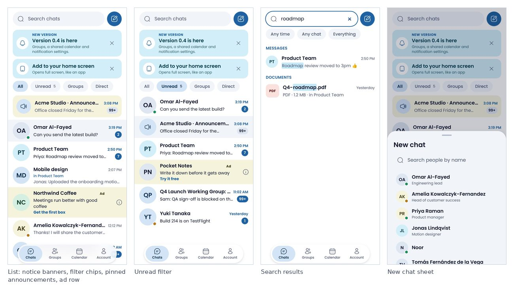

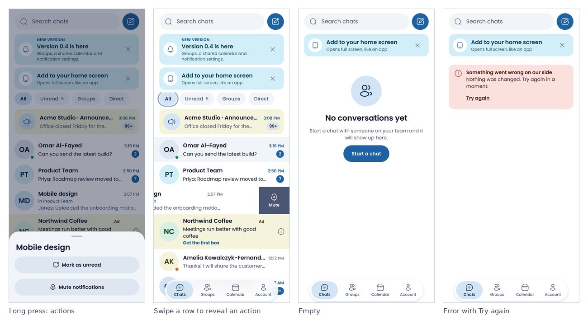

**What is on the screen, top to bottom**

- **Top row:** a search pill and a round new-chat button. No app name.
- **Notice cards** (dismissible): a "new version" notice that opens What's new, and the Add to home screen card on phones (Part J).
- **Filter chips:** All, Unread (with a count), Groups, Direct. The highlight slides to the chosen chip.
- **Announcements chat** pinned at the top as a pale yellow card.
- **Rows:** a round 56 px avatar (groups are circles too, with an online dot for people), the name, a one-line preview, the time on the right (brand blue when unread) and an unread count badge. When the last message is yours, delivery ticks come before the preview. Sub-group rows show "in [parent group]". A chat you muted shows a small bell-off mark and a grey badge. A chat marked unread shows a dot and a bold title.
- **An ad row** (free plan, personal chats only) after the third chat (Part I).

**Flows**

1. **Open a chat:** tap a row.
2. **Start a chat (CHT-01):** tap the round button, search members by name (SRC-01), tap a person. If a chat with them exists it opens.
3. **Search (SRC-02 to SRC-04):** type in the search pill. Results are grouped into Chats, Messages and Documents, with matched words highlighted, and filters for date (any, today, week, month), chat, and type (all, images, documents). Tapping a message opens its chat and highlights that message.
4. **Chat actions:** long press opens a sheet with Mark as unread / Mark as read and Mute / Unmute. Swiping a row right reveals read/unread and swiping left reveals mute. A long swipe runs the action at once, a short one leaves the button showing, and only one row is open at a time.
5. **Pull to refresh** on phones. The list refreshes without showing the loading skeleton; a failure keeps what is on screen.

**Rules**

- Newest chat first. A chat that gets a new message glides to the top.
- A group chat's mute is the same setting as the mute on its group page.
- Unread filter counts chats marked unread by hand too. Opening a chat clears the flag.
- Realtime: new messages, presence and unread counts update live (NFR-01).

**States:** loading (skeleton rows), empty ("No conversations yet" with Start a chat), error (Try again), offline (banner, cached list stays).

**Phases**

| Phase | What gets built | Exit check |
|---|---|---|
| B1 | List with rows, avatars, previews, times, unread badges, pinned announcements; open a chat; all four states | Matches the screenshots on 360 to 440 px wide phones |
| B2 | Filter chips, search pill, new-chat sheet with member search | Finding a person and starting a chat takes under 5 seconds |
| B3 | Message and document search with grouped results, filters and highlighting | Tapping a result opens the chat scrolled to that message |
| B4 | Row actions: mark unread/read, mute, long press, swipe, pull to refresh | Every swipe action is also in the long-press sheet |
| B5 | Realtime: new messages, presence, unread, rows that move; load tolerance (NFR-02) | List stays correct while 20 messages arrive in a second |

Wire later: `chat.messages`, `search.members`, `search.query`.

---

### Part C. Conversation  (CHT-01 to CHT-05, MED-01 to MED-05)

**What people do:** read and write messages, send photos and documents, copy or delete a message, open someone's info, call from the top bar.

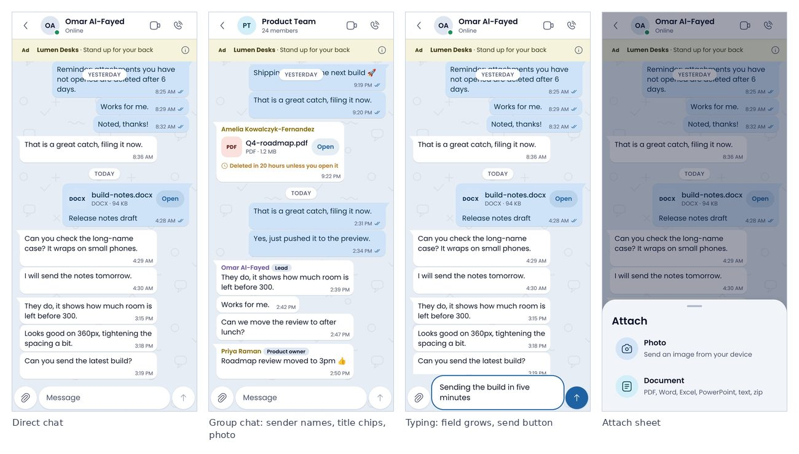

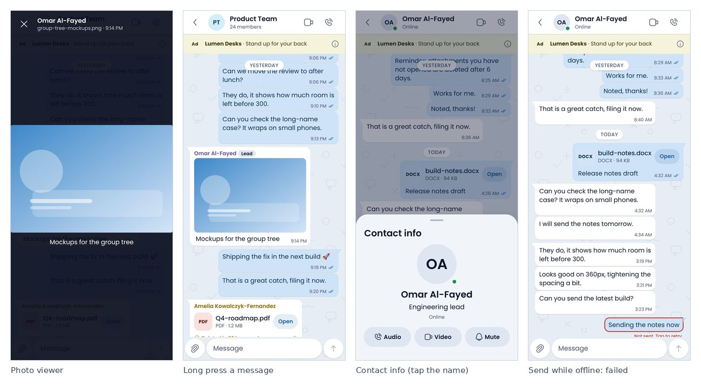

**What is on the screen**

- **Top bar:** back arrow, avatar, name and status (online, away, members count), and phone and video buttons (not in the announcements chat or a group you left). **Tapping the name opens info:** contact info for a person, group info for a group.
- **Wallpaper:** a soft blue pattern. Day separators are small capital pills ("TODAY", "YESTERDAY").
- **Bubbles:** incoming white, outgoing light blue, 12 px corners, a small tail on the first bubble of a run. The time and double tick are inside the bubble at the bottom right. In groups the sender's name sits above their bubble in their own color, with their title tag next to it.
- **Composer:** an attach button, a white pill text field that grows as you type, and a round send button.
- **An ad banner** under the top bar, free plan and personal chats only (Part I).

**Flows**

1. **Send:** type, tap send. The bubble rises from the composer showing a clock (sending), then ticks when delivered. Failure turns it red with "Not sent. Tap to retry".
2. **Attach (MED-01 to MED-03):** attach button opens a sheet, the person chooses a photo or document, sees a preview with an optional caption, then sends. Photos show as a thumbnail (caption-less ones fill the bubble); documents show as a row with icon, name, size and Open. Files over 25 MB are refused with a plain message. A failed send keeps the file and offers retry.
3. **Open a photo:** full-screen viewer with Close. Pinch to zoom up to 5 times, double tap to zoom in and out, drag a zoomed photo, pull a normal-size photo up or down to close.
4. **Message menu:** long press a message. The rest of the chat blurs, the message lifts and a card appears with **Copy** (any message with text), **Delete** (your own messages, **private chats only**, CHT-05) and **Try again / Discard** for a failed message.
5. **Contact or group info:** tap the name in the top bar. Contact info shows a large photo, name, job title, status and Audio, Video, Mute. Group info is Part D.
6. **Download setting (MED-05):** received photos and files follow the account setting (always, Wi-Fi only, never). On mobile data with Wi-Fi only a tap-to-download tile shows the size. Opened files are kept on the device (DAT-03). Expired files show a short note.

**Rules**

- A person cannot delete messages in group chats, ever, and cannot delete other people's messages.
- A group you left but kept shows a read-only note instead of the composer (ROL-05).
- Drafts are kept per chat while you move around.
- Announcements chat (CHT-03) shows messages; posting is allowed in the prototype (assumed).

**States:** loading (skeleton bubbles), empty, error with retry, offline (banner), sending, failed.

**Phases**

| Phase | What gets built | Exit check |
|---|---|---|
| C1 | Conversation shell: top bar, bubbles, day separators, composer, scroll behaviour (opens at the newest message) | A 500-message chat scrolls smoothly both ways |
| C2 | Send with sending, delivered and failed states, retry, realtime incoming messages | Airplane mode produces a red failed bubble that retries successfully |
| C3 | Group chat details: sender names and colors, title tags, sub-group chats, read-only left groups | Matches the group screenshot |
| C4 | Message menu: copy, delete (private only), discard | Delete is absent in group chats |
| C5 | Attachments: attach sheet, preview with caption, thumbnails, document rows, size limit, retry | A 26 MB file is refused with the plain message |
| C6 | Photo viewer and download setting, caching, expiry notes | Zoom, double tap and pull-to-close all work and Close always works |
| C7 | Contact info sheet and header calls | Tapping the name always opens the right info |

Wire later: `chat.send-message`, `chat.delete-message`, `media.upload`.

---

### Part D. Groups and teams  (GRP-01 to GRP-11, ROL-01 to ROL-06)

**What people do:** browse a tree of groups and sub-groups, join by link, leave, and (admins) create, invite, block, archive and delete groups.

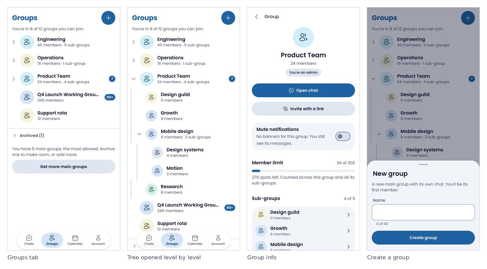

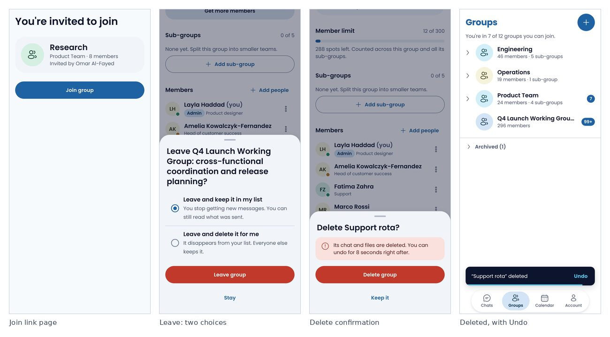

**What is on the screen**

- **Groups tab:** a line "You're in 8 of 12 groups you can join", then a tree. Each row has an avatar, name, member count and sub-group count, an unread badge and a chevron to open its sub-groups. An **Archived** section sits at the bottom.
- **Group info page:** the group's chat button, invite link, mute switch, a **member limit meter** (admins only, counted across the main group and all its sub-groups, with places left), sub-groups, members with title tags and Blocked tags, and for admins Add people, Add sub-group, Archive and Delete.
- A round plus button creates a main group (admins).

**Flows**

1. **Open a group:** tap its name, which goes straight to its chat. Info opens from the chat's top bar. An archived group has no chat so it opens its info.
2. **Create (GRP-01, GRP-08):** admins only. A sheet asks for the name (40 characters). Sub-groups are created from a parent's info page. A full parent (5 children) disables Add and explains why, with a button to buy more room (Part I).
3. **Invite (ROL-01, ROL-02):** admins add people from a searchable checklist (stops at the 300 cap with a clear message) or share a link; members can share the link too. No approval needed (assumed).
4. **Join by link (GRP-06):** a link opens a page showing the group, its path and who invited. Signed-out people sign in or sign up and return to it. If the app is not installed the link goes to the app store first (GRP-07, native apps only).
5. **Block (ROL-03):** admins block or unblock from a member's menu. Blocked people stay listed with a Blocked tag and cannot post or receive new messages in that group (assumed).
6. **Title tags (ROL-04):** short free text (up to 24 characters) set by an admin, shown in member lists and beside the sender's name in group chats. They carry no permissions (assumed).
7. **Leave (ROL-05, ROL-06):** a sheet with two choices: leave and keep it in my list (read only, composer replaced by a note) or leave and delete it for me only.
8. **Delete (GRP-09, GRP-10):** admins only. A confirmation sheet says what goes with it, then a bar at the bottom reads "deleted" with **Undo** and a countdown (8 seconds, a database value). The row folds away before the list updates. Undo brings it back and it glides into place.
9. **Archive (GRP-11):** reversible; sends the group and its sub-groups to Archived, which are deleted after 90 days (assumed). Archived groups show their deletion date.

**Rules**

- Hierarchy: 5 groups, 5 sub-groups under each, 5 sub-sub-groups under each (assumed per parent). Archived groups do not count.
- Only admins create groups, delete groups and block people.
- Flights (GRP-03, GRP-04) are **not built**: waiting for product answers (who creates them, what "progress of tasks" means, who sets auto-hide).

The whole group info page, top to bottom, and the join link as a signed-out person sees it:

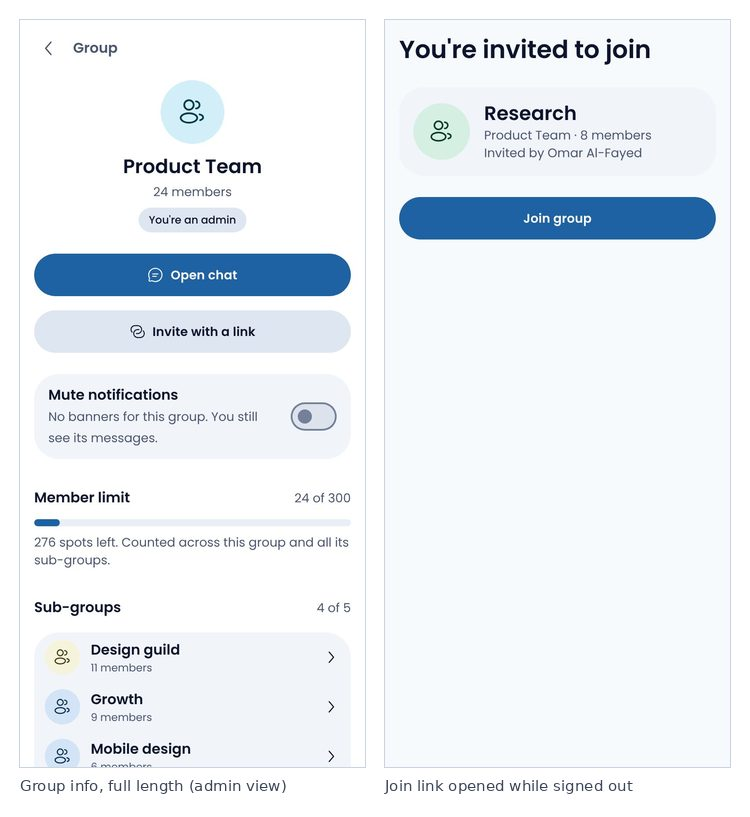

**States:** loading, empty ("You're not in a group yet", or "No groups yet" with Create for admins), error with retry, offline.

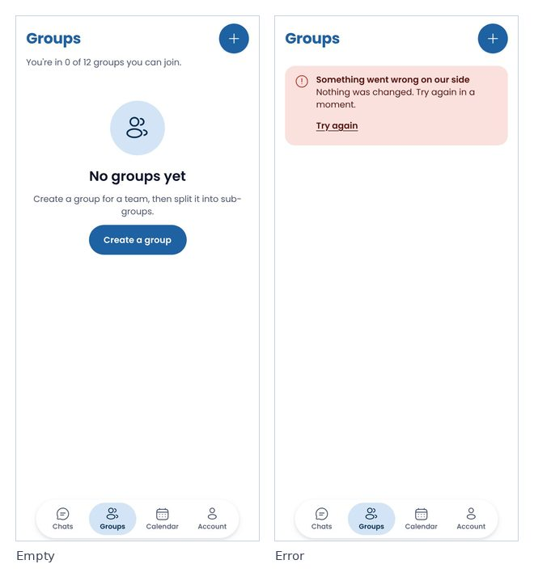

**Phases**

| Phase | What gets built | Exit check |
|---|---|---|
| D1 | Groups tab with the tree, counts, unread badges, open straight to chat, group info page | A 5 / 5 / 5 tree with 300 members renders and scrolls smoothly |
| D2 | Create group and sub-group, the limits (per-parent cap, per-user cap, full-parent message), server enforcement | A sixth child is refused by the server and the screen explains why |
| D3 | Invites and join links, members list, add people checklist, member cap and meter, title tags | A link taps through to joined, including from signed-out |
| D4 | Leave (two options), block and unblock, read-only groups | A kept group shows the read-only note; a deleted-for-me group is gone only for that person |
| D5 | Archive and delete with undo, retention date, Archived section | Undo within 8 seconds restores everything, after that it does not |
| D6 | Flights (after product answers) | Not scoped |

Wire later: `groups.crud`, `groups.join-link`, `members.invite`, `roles.permissions`, `roles.title-tags`.

---

### Part E. Calendar  (CAL-01, CAL-02)

**What people do:** see a month, pick a day, read its events, and choose which calendars to show. Admins also choose who has each calendar.

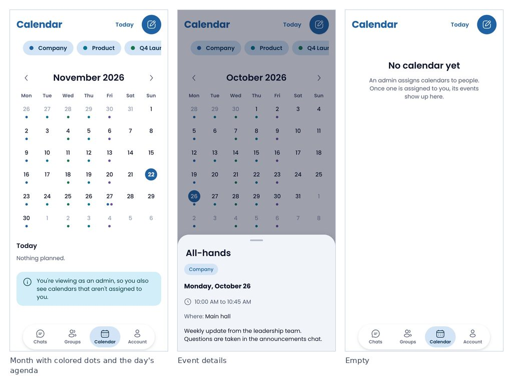

**Rules**

- A month grid with colored dots; the picked day's events are listed below; tapping one opens details. Weeks start on Monday (assumed).
- Chips show or hide each calendar. People see only calendars assigned to them. Admins see all of them, with a "not yours" tag on the others and a pencil that opens a list where they choose who has each calendar (CAL-02).
- Events come from the organization and arrive from the server; there are no personal events or reminders yet.
- Pull to refresh on phones.

**Phases**

| Phase | What gets built | Exit check |
|---|---|---|
| E1 | Month grid, day agenda, event details, empty and error states | Navigating months is instant |
| E2 | Calendar chips and per-person assignment, admin view and assign sheet | A person never sees a calendar that was not assigned to them |
| E3 | Live events: calendars and events arrive from the server and update in the app | An event added on the server appears in the app within seconds |

Wire later: `calendar.events`.

---

### Part F. Notifications and updates  (NTF-01 to NTF-03, NFR-03)

**What people do:** see app news inside the app, get pushed when something arrives, and choose what they are notified about.

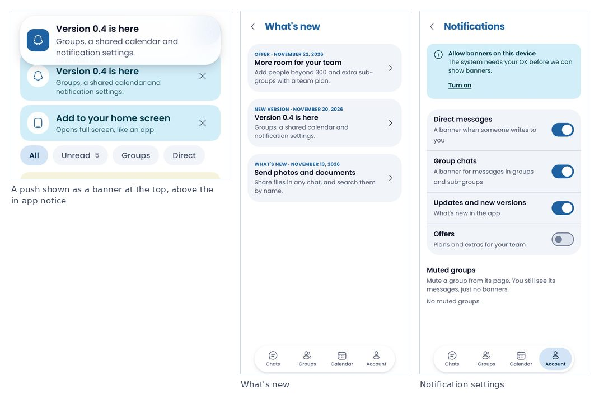

**Flows**

1. **In-app banner (NTF-01):** a dismissible notice under the search field on the chat list, such as "Version 0.4 is here". Tapping it opens What's new. Dismissing remembers the choice.
2. **What's new:** Account, What's new lists releases, public updates and offers, newest first, each opening its own page.
3. **Push (NTF-02, NTF-03):** a banner slides down from the top. Tapping it opens the chat or the release, update or offer page. It stays quiet for the chat you are looking at.
4. **Settings:** Account, Notifications has switches for direct messages, group chats, updates and offers. The system permission is only requested after our own sheet explains why. A group's info page has its own Mute notifications (the same mute used on the chat row).

**Rules:** notification infrastructure must be live on launch day (NFR-03). Pushes use the same wording as the in-app text.

**Phases**

| Phase | What gets built | Exit check |
|---|---|---|
| F1 | In-app banner, What's new list and pages, dismissal memory | A new release notice reaches every signed-in user without an app update |
| F2 | Notification settings, own permission sheet then the system request, denied state with how to enable it | A denied permission shows where to turn it on |
| F3 | Push: chat and group pushes, quiet in the open chat, tap opens the right place | Tapping a push from a closed app opens the right chat |
| F4 | Release, update and offer pushes (NTF-03) | Same, for pages |

Wire later: `notifications.in-app-banner`, `notifications.push`.

---

### Part G. Calls  (CLL-01 to CLL-05)

**What people do:** call one person or a group, with or without video, within a daily time allowance.

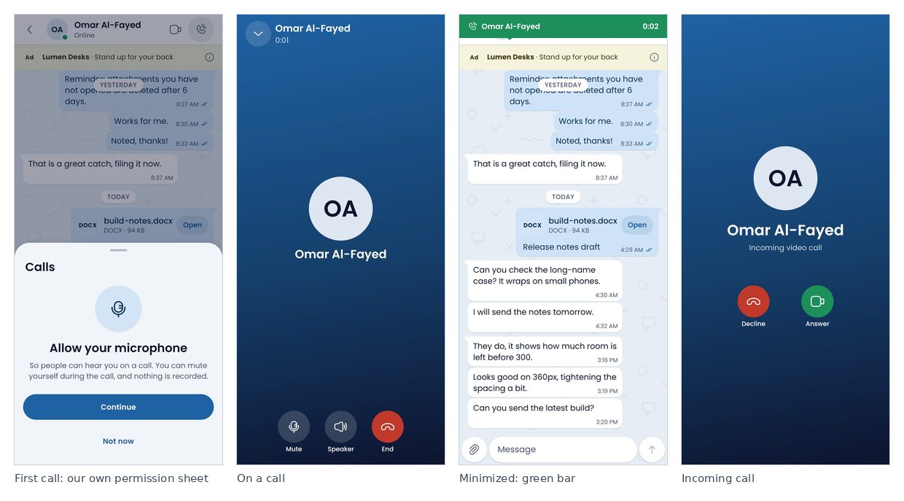

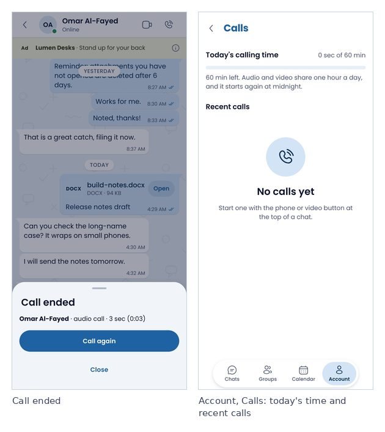

**Flows**

1. **Place a call:** tap the phone or video button in the chat's top bar (not in announcements, not in a group you left). The first time, our own sheet asks for the microphone (and camera for video) before the system does.
2. **On the call:** a brand-blue screen with a minimize arrow, the name and a timer. A 1-to-1 call shows one large person (video adds a small self view). A group call shows a grid of up to 5, the current speaker ringed, people who have not answered dimmed. Controls: mute, camera, speaker, end.
3. **Minimize:** the arrow, or pulling the screen down, tucks the call into a green bar at the top. Tapping the bar brings it back.
4. **Incoming:** fills the screen with Answer and Decline. Answer pops, and gently breathes while ringing.
5. **Ended:** a sheet shows the call length with Call again and, if nobody answered, Send a message.
6. **The daily allowance (CLL-05):** one hour per person per day, shared by audio and video. Warnings at 5 minutes left and under 1 minute; at zero the call ends and says why. Account, Calls shows today's time against the hour and recent calls with a call-back button. Missed and declined calls are listed there.
7. **Group calls (CLL-02, CLL-04):** the caller plus up to 4 more; the app rings online members first.

**Rules:** the call vendor is Zeego Cloud (DEP-01), behind a call service. The server enforces the daily cap and the 5-person limit. Calls are never placed in announcement chats.

**Phases**

| Phase | What gets built | Exit check |
|---|---|---|
| G1 | Call service connection, 1-to-1 audio, permission sheet, call screen, end, ended sheet | Two phones can talk |
| G2 | 1-to-1 video, camera and speaker controls, self view | Video toggles mid-call |
| G3 | Daily cap (server), warnings, call ends at zero with reason, Account, Calls | Cap holds across audio and video and resets at midnight |
| G4 | Incoming calls, minimize and the green bar, background and lock-screen behavior | An incoming call rings while the app is closed |
| G5 | Group and sub-group calls up to 5, grid, speaker highlight | A sixth person is refused |

Wire later: `calls.service`.

---

### Part H. Account, profile and data  (PRF-01, MED-05, DAT-01 to DAT-04)

**What people do:** edit their profile, choose how media downloads, see what will be deleted, back up and move chats to a new phone.

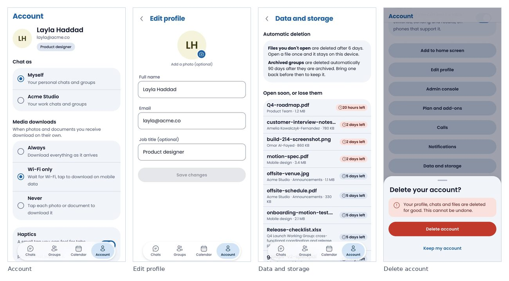

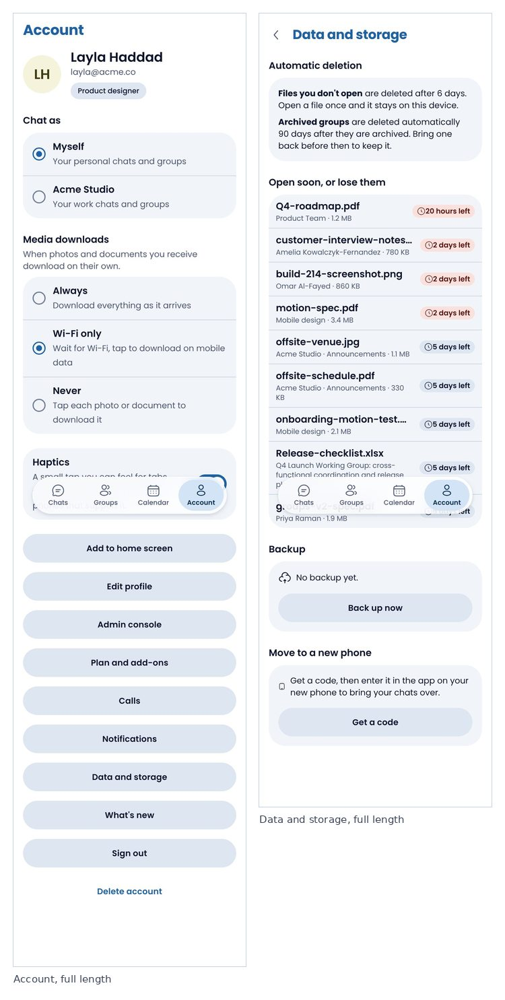

**What is on the Account screen:** name, email and title, "Chat as" (identity), Media downloads (Always, Wi-Fi only as default, Never), Haptics switch, Add to home screen (when not installed), Edit profile, Plan and add-ons, Calls, Notifications, Data and storage, What's new, Sign out, Delete account.

**Flows**

1. **Edit profile (PRF-01):** name, email, job title, photo (choose or remove). Save stays disabled until something changes. A success banner confirms; an email already in use shows an inline error.
2. **Media download (MED-05, DAT-03):** the three choices above; opened photos and videos stay on the device.
3. **Retention (DAT-02, DAT-04):** Account, Data and storage explains in plain words that unopened files are deleted after 6 days (15 for business), archived groups after 90, and lists files about to be deleted; tapping one jumps to it. Inside chats an unopened file reads "Deleted in N days unless you open it" once 3 days or fewer are left.
4. **Backup and transfer (DAT-01):** Back up now, and a 6-digit code (valid for 10 minutes, single use) to move chats to a new phone.

**Phases**

| Phase | What gets built | Exit check |
|---|---|---|
| H1 | Account screen, edit profile with photo, sign out, delete account | Changes show everywhere the name or photo appears |
| H2 | Media download setting and on-device cache | Wi-Fi only really holds back downloads on mobile data |
| H3 | Retention rules, list of files about to expire, in-chat expiry notes (server deletes) | A file really disappears on the day it says |
| H4 | Backup and the 10-minute transfer code | A new phone restores chats with the code |

Wire later: `profile.edit`, `data.retention`, `data.backup`.

---

### Part I. Plan, ads and purchases  (MON-01 to MON-04)

**What people do:** use the free plan with ads, or buy add-ons that raise limits and remove ads.

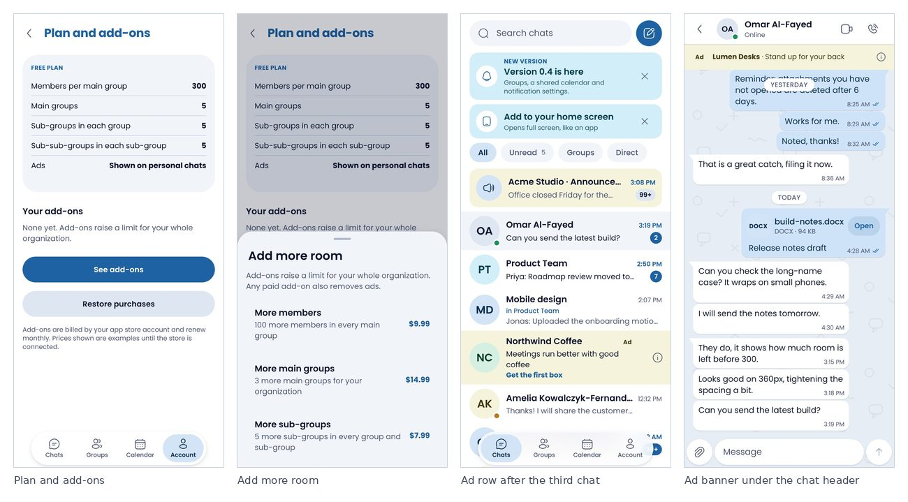

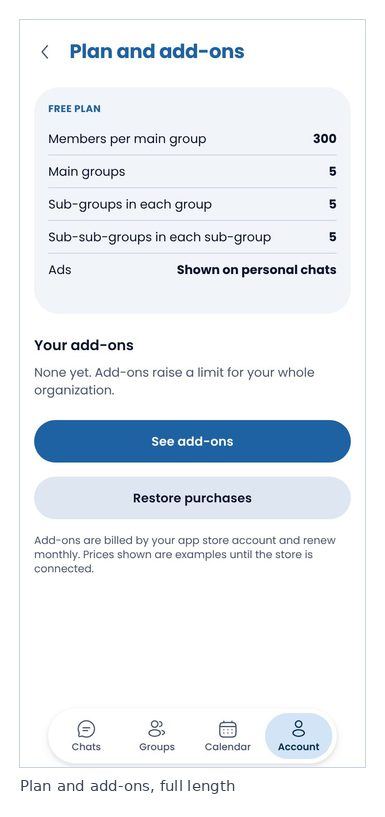

**Rules**

- **Ads (MON-01, MON-02):** free plan only, personal chats only (never organization chats). One ad row in the chat list after the third chat, and one slim banner under a chat's header. Each carries an Ad tag and an info button that explains why you see it, links to add-ons and can hide it for the visit. Any paid add-on removes ads (assumed).
- **Add-ons (MON-03, MON-04):** three monthly examples: 100 more members per main group, 3 more main groups, 5 more sub-groups per group. Prices come from the store exactly as given. Admins buy; members see the same screens but cannot.
- **Buying:** choose an add-on, confirm with the price and renewal terms, then a clear success or failed-payment screen with Try again. **Cancel** runs to the end of the month paid for, nothing is deleted. **Restore purchases** is always available.
- **Where a limit is hit** (sub-groups full, main groups full, member cap) a button offers the matching add-on.
- Purchases use RevenueCat (MON-04).

**Phases**

| Phase | What gets built | Exit check |
|---|---|---|
| I1 | Plan screen showing current limits from the server | The numbers always match what the server enforces |
| I2 | Ad placements and the info sheet, free plan and personal chats only | An organization chat never shows an ad |
| I3 | Purchase flow via RevenueCat, success and failed states, cancel and restore | A purchase raises the limit immediately and removes ads |
| I4 | Limit-hit prompts in Groups and the member cap | Hitting a limit offers exactly the right add-on |

Wire later: `monetization.ads`, `monetization.purchases`, `config.limits`.

---

### Part J. Platform: install, permissions, offline and native feel  (NFR-04, DEV-01 to DEV-04)

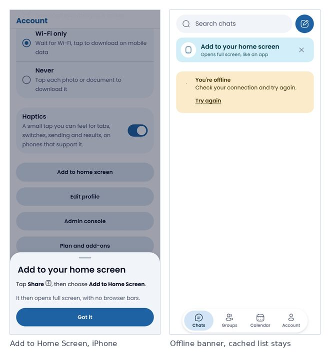

- **Add to home screen (web version):** a card under the notice on the chat list on phones, and Account, Add to home screen. Android gets one button; iPhone gets one line ("Share, then Add to Home Screen"); people inside another app get a link to copy and open in their browser. Closing the card hides it for a week. Nothing shows once installed.
- **Permissions (NFR-04):** for each (photos, microphone and camera, notifications) our own sheet explains why first. Allow continues to the system request; Not now returns. If denied, the same place shows how to turn it on in settings. Nothing ever asks without explaining.
- **Offline:** an offline banner on every screen, cached content stays visible, sending waits or fails visibly with retry.
- **Native feel on touch screens:** no text selection except in fields, no page zoom, no browser long-press menus, no image dragging, no scrollbars, no browser pull-to-refresh. Text fields are 16 px so iPhone does not zoom. Copying a message is in its long-press menu.
- **Haptics:** five kinds of tap (selection, light, success, warning, error) with an Account switch that turns them all off; the full list of when each one fires is in Section 5.
- **Device integrations (DEV-01 to DEV-04):** the app in the device's suggested contacts, seeing people from device contacts, an email icon opening the mail app, appearing in the share sheet. **Not built** in the prototype (native only).
- **Store distribution (DEP-03, DEP-04):** Apple and Google developer accounts are new and required. The join link falls back to the app store (GRP-07).

**Phases**

| Phase | What gets built | Exit check |
|---|---|---|
| J1 | Permission sheets and denied states for photos, microphone, camera, notifications | Each denial is recoverable from the same screen |
| J2 | Offline handling and the offline banner everywhere | Airplane mode never shows a blank screen |
| J3 | Native feel rules and haptics (all five kinds, the Account switch, off under Reduce Motion) | Every haptic in Section 5 fires once in the right place and nowhere else; the switch silences all of them |
| J4 | Store distribution and join-link fallback | A join link works from a phone without the app |
| J5 | Device integrations DEV-01 to DEV-04 | Each opens the right native screen |

Wire later: `permissions.runtime`.

---

## 5. Motion: how the app moves

**Principle:** motion explains what just happened (where a screen came from, what you picked up, what finished). It follows Apple's Human Interface Guidelines: springs instead of fixed easing, quick, interruptible, never decorative. Anything that moves has an equivalent without movement.

### Springs (the only timing curves used)

Springs are described by how quick they are and how much they bounce. Build them as native springs (SwiftUI/Core Animation spring, Android spring animation) with these values, or as curves matching the durations.

| Name | Feels like | Settles in | Used for |
|---|---|---|---|
| Smooth | Quick, no bounce | about 330 ms | Screens, sheets, list changes, rows that move, things you drag |
| Smooth, slow | Same, longer | about 430 ms | Big moves that need a moment |
| Snappy | A hint of life | about 240 ms | Taps, toggles, the sliding highlight, message and menu pops |
| Bouncy | Playful | about 640 ms | Rare delight only: answering a call, a finished purchase or install |
| Fade (fast, normal, slow) | Never overshoots | about 150, 230, 330 ms | Colors and opacity: press feedback, banners, content appearing |

### What moves, and how

| Moment | What happens |
|---|---|
| **Press feedback** | Immediate, in the same frame as the touch. Rows get a soft grey highlight. Buttons, chips and icons dim. Big buttons also shrink by 2%. Release springs back. No delay on taps. |
| **Switching tabs** | Instant. No slide, no fade. A selection haptic. |
| **Opening a chat or group** (phone) | The new screen slides in from the right over the list (Smooth). The list underneath moves back 28% and dims. The tab bar slides down and away. Going back reverses it. The screen stays visible until it has finished leaving. |
| **Swipe back** | Start within 28 px of the left edge and drag right. The screen follows the finger one to one and the list moves and brightens with it. Past a third of the width, or a quick flick, goes back; otherwise it springs open again. Touch only, never a mouse. Not available over the top bar or message field so their buttons stay tappable at the very edge. |
| **Other pushed pages** (Account pages, What's new) | The new page slides in from the right and the old one moves back a little. Back reverses it. |
| **Sheets** | Rise from the bottom with a dim behind. Drag down to close: it follows the finger, a small pull springs back, a long pull or flick closes. Pulling past the top resists like rubber. Long sheets (New chat, Add people, Add room, Assign calendar) open half way; pull up for full height. Escape or tapping outside also closes with the slide. |
| **Photo viewer** | Pinch to zoom up to 5 times, double tap to zoom in around the tap and again to zoom out, drag a zoomed photo within its edges, pull a normal photo up or down to close while the background fades. |
| **Call screen** | Rises from the bottom. Pull it down to tuck it into the green bar; tap the bar to bring it back. The control buttons do not start a drag. |
| **Message long press** | After about 0.45 s the rest of the chat blurs, the message lifts where it is and a card pops in beside it from its corner. |
| **Sending and receiving** | Your message rises from the composer. Theirs slides in softly. Ticks pop when delivered. Messages already on screen when a chat opens do not animate. |
| **Rows** | A chat that moves to the top glides there. A deleted group folds away before the list updates, and glides back on Undo. Swiping a row follows the finger. |
| **Pull to refresh** | The content follows the finger with a rubber band, a spinner turns with the pull, and past the trigger it refreshes without showing the skeleton. |
| **Filters and segmented controls** | The highlight slides to the chosen option (measured, so it fits any label). |
| **Small touches** | Ticks and success marks draw themselves. A wrong field shakes once. Lists fade in (fast) as they replace their skeleton. The message field grows and shrinks smoothly. Call buttons spring; the Answer button gently breathes while ringing and pops when tapped. Large page titles shrink and a hairline appears as you scroll. |

### The same moments as film strips

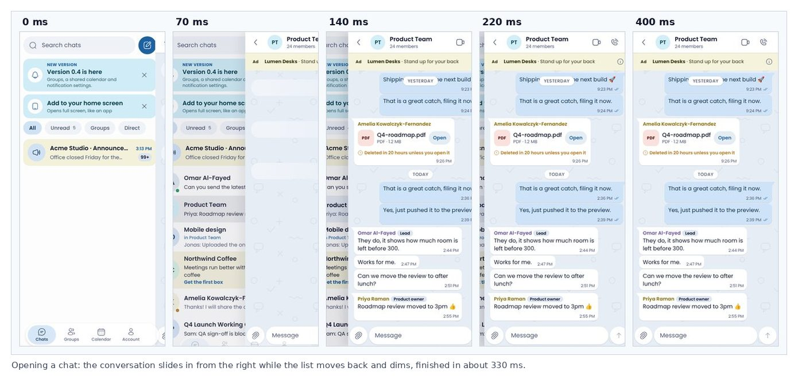

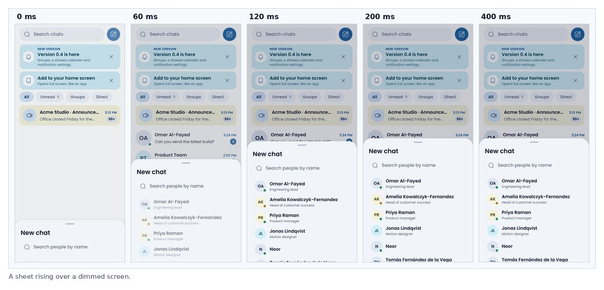

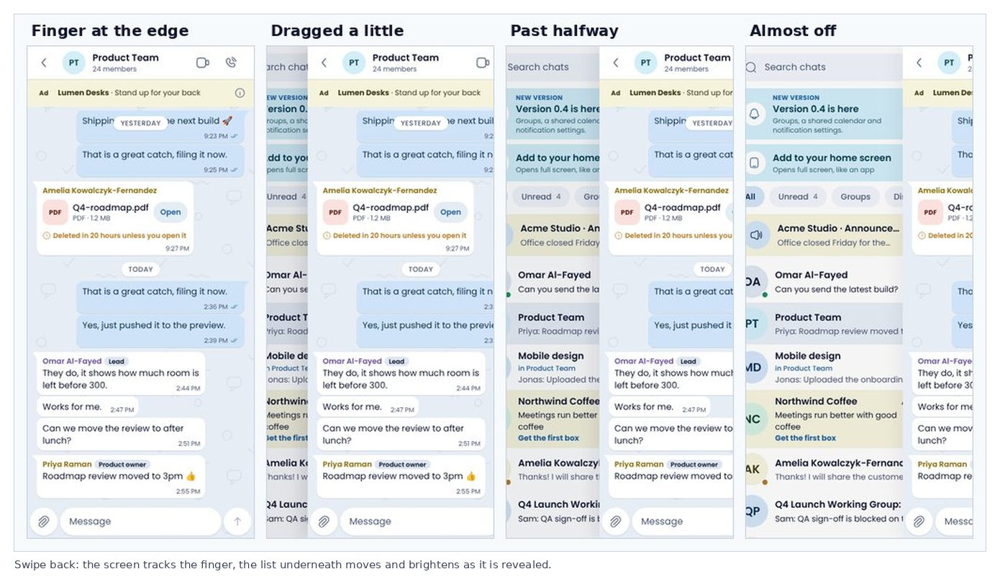

### Haptics (the tap you feel)

Haptic feedback is part of the product's feel: a small physical tap that matches something you can see, the same kind for the same event, and never on every touch. There are exactly five kinds.

| Kind | Meaning | Feels like | When it fires |
|---|---|---|---|
| **Selection** | Moving between choices | The lightest tick | Switching a tab. Choosing a filter chip (All, Unread, Groups, Direct). Choosing an option in a segmented control. Flipping a switch. Pulling to refresh past the point where it will trigger. Swiping a chat row far enough that the action is ready to run |
| **Light** | A small action landed | A single soft tap | Sending a message. Hanging up a call. A long press that opens a chat's actions. A long press that lifts a message into its menu. A swipe on a chat row that runs its action |
| **Success** | Something finished | Two quick taps | Answering a call. A purchase completing. A backup finishing. A pull to refresh finishing |
| **Warning** | A confirmed removal | Two firmer taps | Deleting a group. Deleting a message |
| **Error** | Something failed | Three taps in a row | A message that failed to send. A payment that failed |

**Rules**

- A haptic fires in the same instant as the thing it matches, inside the person's own touch, never on its own and never later.
- Never for scrolling, ordinary taps on buttons and rows, typing, or anything that repeats quickly. If it would fire many times a second, it does not fire.
- One haptic per event. Never two at once, and never one on top of an animation that already has one.
- **Account has a Haptics switch.** It is on by default. When it is off, nothing fires.
- Nothing fires when the system's Reduce Motion is on.
- If the device cannot do haptics, nothing happens and nothing breaks. There is no sound or visual stand-in.

**How to build it on each platform**

- **Native iPhone app:** use the system's selection, light impact and notification (success, warning, error) feedback. Map the five kinds one to one.
- **Native Android app:** use the system's tick, light and confirm / reject feedback constants, or short vibrations. Map the five kinds one to one.
- **The web version (the prototype):** Android browsers accept short vibrations (selection about 6 ms, light about 10 ms, success two 12 ms taps, warning two 18 ms taps, error three 26 ms taps). Safari on iPhone does not allow vibration, so the prototype uses an unofficial trick: Safari 17.4 and later answers a hidden switch control being toggled, but only inside a real touch. It works today and may stop working, so the guide's behavior above is the product requirement and the trick is only the way the prototype reaches it.

**Check on real phones:** whether each kind feels distinct from the next, whether any event fires twice, and that turning the Haptics switch off silences everything.

### Reduce Motion

When the system's Reduce Motion is on, every slide and grow becomes a short (about 140 ms) fade, drawing, shaking, breathing and bouncing stop, and sliding highlights just jump. Touch feedback stays: stillness is not silence.

### Rules for any new motion

Use one of the springs above. It must explain something. It must be interruptible (a new touch takes over). It must have a Reduce Motion answer. Gestures must have a visible alternative (sheets close from a tap outside, the viewer has Close, chats have Back).

### Check on real phones

The prototype is tested in an emulator. On real devices check: haptic feel, Safari's and Android's own back gestures against ours (move our edge strip a few pixels in if they compete), blur performance on older phones, and tune the spring numbers by feel.

---

## 6. States: every screen, including the bad moments

A screen is not done until all of these exist. These are the shared patterns.

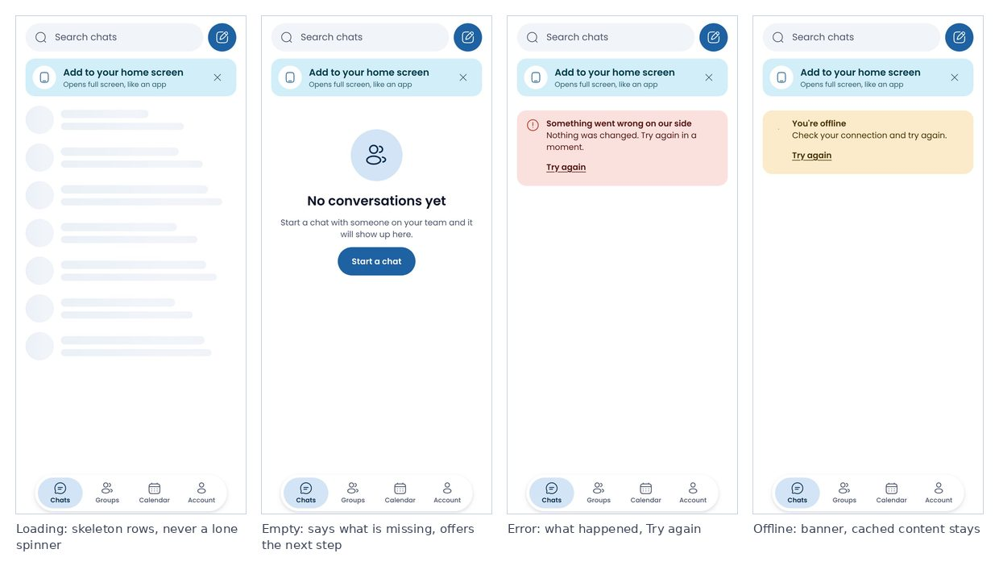

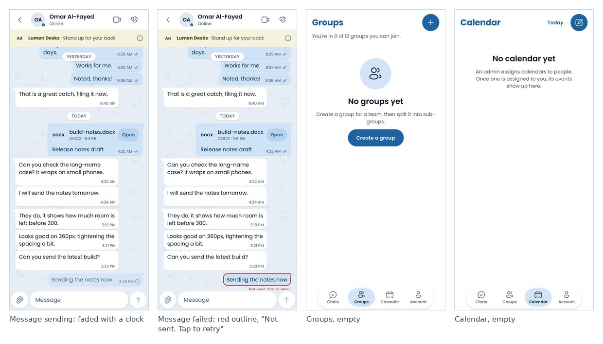

**Rules that apply everywhere**

- Errors say what happened in plain words and offer one next step. They never blame the person, and they say "Nothing was changed" when true.
- A failed action keeps what the person typed or picked.
- Offline never shows a blank screen. Cached content stays, and actions queue or fail visibly.
- Tab roots (chat list, Groups, Calendar) show what was last loaded at once and refresh quietly, instead of a loading screen on every visit.
- Long names, long messages, no avatar, emoji and big numbers (99+) must not break a row. Test with a 300-member group, a 5 / 5 / 5 tree, and hundreds of unread.

---

## 7. Overall build order

The parts above fit together in this order. Each phase ends with an exit check that a person can try. Work inside a phase can run in parallel across the three engineers; phases themselves depend on earlier ones. "Gate" means a product answer is needed first.

| Phase | Goal | Parts and sub-phases | Exit check | Gate |
|---|---|---|---|---|
| **0. Foundations** | Decisions and plumbing | Client framework and backend choice; environments and CI; design tokens, icons, type and the shared components in Section 2; one place for business limits; the placeholder-to-real swap list (`WIRING.md`); analytics hook; Apple and Google developer accounts | A blank signed-out screen in the right fonts and colors runs on an iPhone and an Android phone | Framework, backend, vendor names |
| **1. Sign in and shell** | A person can get in | A1, A2, J1 (permission sheet pattern), J2 (offline banner), the four-tab shell, loading / empty / error pattern | Create account, close app, reopen: still signed in. Tabs switch instantly | Email verification (A5) |
| **2. Messaging core** | Chat works in realtime | B1, B2, B4, B5, C1 to C4, C7 | Two phones chat in realtime, a message retries after airplane mode, delete works only in private chats | None |
| **3. Media, search, profile** | Rich chat | B3, C5, C6, H1, H2, J3 | Send a photo, find a message from last week, change the profile photo | Document types, file size |
| **4. Groups and roles** | Teams | D1 to D5, A3, A4 | A 5 / 5 / 5 tree, invite by link, leave in both ways, delete with 8-second undo, the cap enforced by the server | Flights, per-user group limit, member approval |
| **5. Calendar, notifications, data** | Daily life | E1 to E3, F1 to F4, H3, H4 | A calendar assigned to a person appears; a push opens the right chat; an unopened file disappears on its day | None |
| **6. Calls** | Voice and video | G1 to G5 | Group call of five, daily hour holds, incoming call rings with the app closed | Vendor SDK details |
| **7. Money and distribution** | Paid plans and the stores | I1 to I4, J4, J5 | A purchase raises a limit and removes ads; a join link works from a phone without the app | Ad placement wording |
| **8. Hardening and launch** | Ready for real people | Load test (NFR-02), real-device motion and haptics tuning, accessibility pass, security review, store review (moderation and report-abuse is expected for user content), notifications live at launch (NFR-03) | The launch checklist below passes | Load numbers, moderation scope |

**Launch checklist:** every screen matches this guide in all its states; all limits are enforced by the server and read from configuration; Reduce Motion works; the app is usable offline-to-online; permissions are explained before the system asks; push works from a closed app; load numbers agreed in Phase 0 are met; store listings, privacy text and account deletion are in place.

---

## 8. Open questions for product

None of these change the agreed scope. Each needs an answer before the phase that depends on it.

| # | Question | Affects | Needed by |
|---|---|---|---|
| 1 | Flights (GRP-03, GRP-04): who creates them, who sees them, what "progress of tasks" means, who sets auto-hide | D6 | Phase 4 |
| 2 | Title tags (ROL-04): who assigns, free text or fixed list, where shown, any permissions | D3 | Phase 4 |
| 3 | Moderators were removed: confirm only admin and member exist | All roles | Phase 4 |
| 4 | Per-user group limit (assumed 12) | D2 | Phase 4 |
| 5 | Is 5 / 5 / 5 per parent or per level in total (assumed per parent) | D2 | Phase 4 |
| 6 | Where exactly ads appear (assumed: free plan, personal chats, one row plus one banner) | I2 | Phase 7 |
| 7 | Who can invite whom, and do member invites need approval (assumed: no) | D3 | Phase 4 |
| 8 | Load numbers: concurrent users, messages per second, launch scale | Phase 8 | Phase 0 |
| 9 | Email verification, and the exact password rules | A2, A5 | Phase 1 |
| 10 | File types and size (assumed 25 MB, images and documents), read receipts and typing indicators | C5 | Phase 3 |
| 11 | Moderation and report abuse (app stores expect it) | Store review | Phase 7 |
| 12 | The exact call vendor name and SDK | G | Phase 6 |
| 13 | Do flights count toward the 300 cap and the 5 / 5 / 5 limits | D | Phase 4 |
| 14 | Retention of archived groups (assumed 90 days) and the undo window (assumed 8 seconds) | D5, H3 | Phase 4 |
| 15 | Which "other essential details" the profile holds besides the job title | H1 | Phase 3 |
| 16 | Existing users accepting an organization invite | A3 | Phase 4 |

---

## 9. Acceptance checklist (use for every phase)

For each screen in the phase, check against the screenshots:

- [ ] Looks the same at 360, 390 and 440 px wide, with and without the iPhone notch and home bar.
- [ ] Has loading, empty, error, offline and success states, and for messaging sending and failed.
- [ ] Uses only the colors, type sizes, spacing, radii and icons in Section 2.
- [ ] Every control has an accessible name and a 48 px touch target. Contrast meets AA.
- [ ] Every gesture has a visible alternative.
- [ ] Haptics fire only where Section 5 lists them, once each, and the Account switch and Reduce Motion silence them.
- [ ] Motion uses only the springs in Section 5, and Reduce Motion replaces slides with a quick fade.
- [ ] Every business limit is enforced by the server and read from configuration, never typed into a screen.
- [ ] Copy is specific and calm (no "Welcome back!", no blame in errors).
- [ ] Long names, long messages, emoji, 99+ badges and 300-person groups do not break layout.
- [ ] The matching placeholder is replaced by the real service and its row in `WIRING.md` is marked done.
