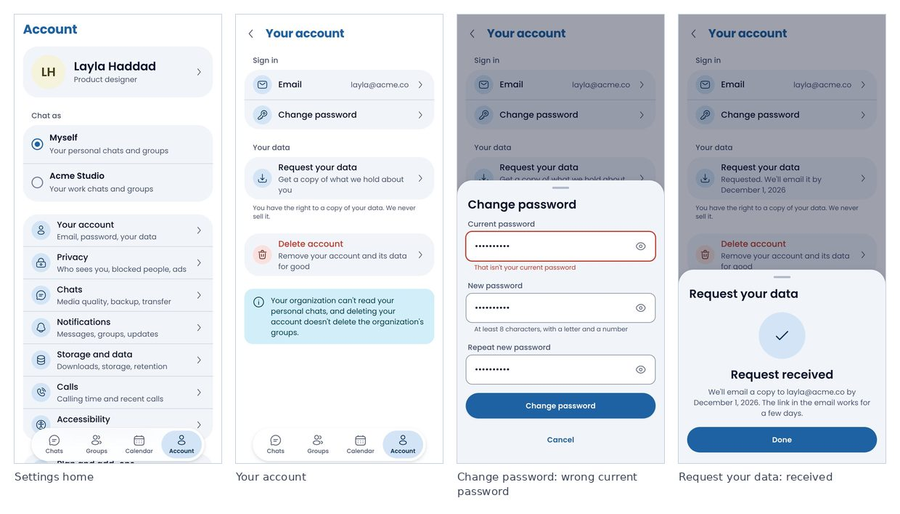
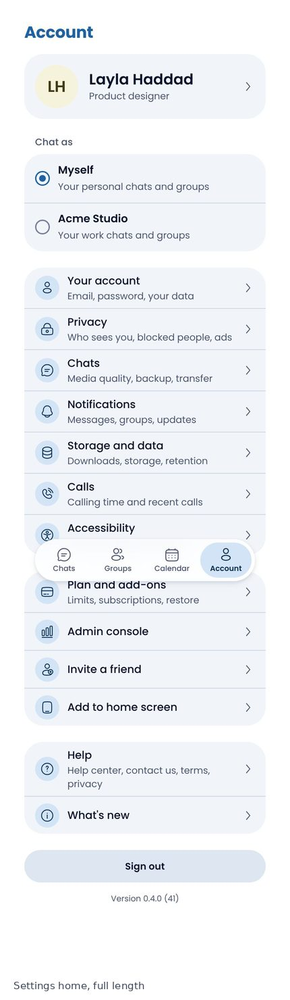
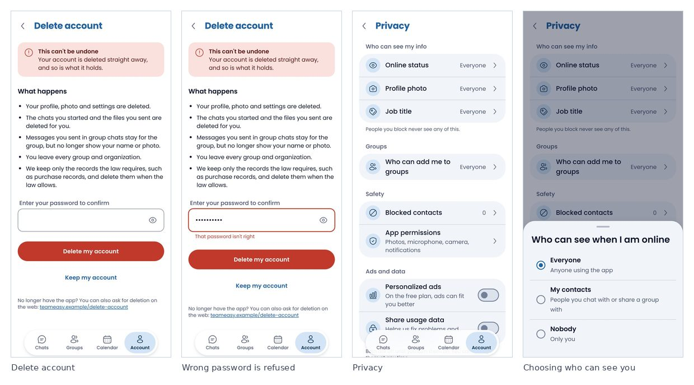
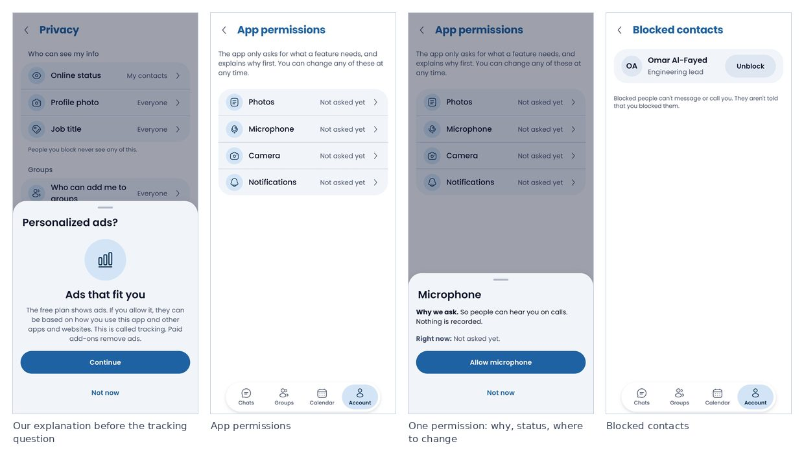
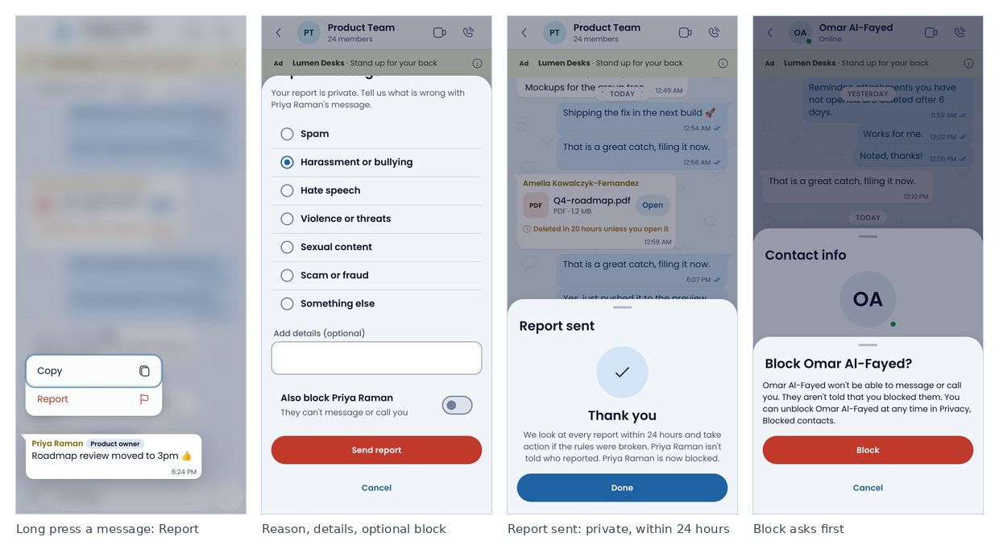
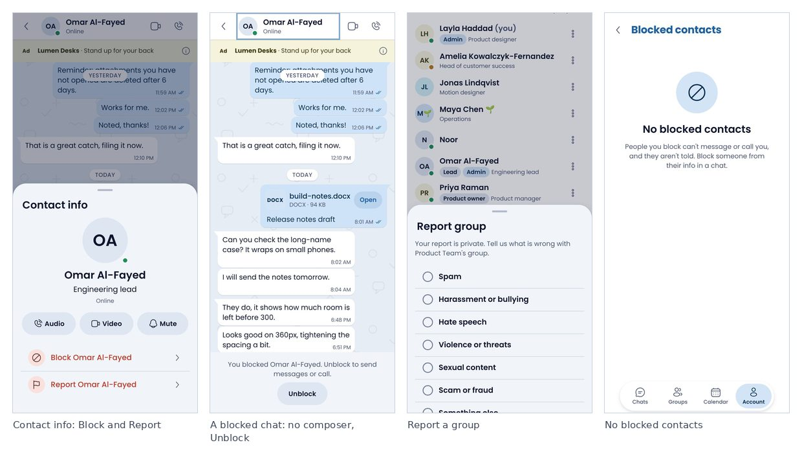
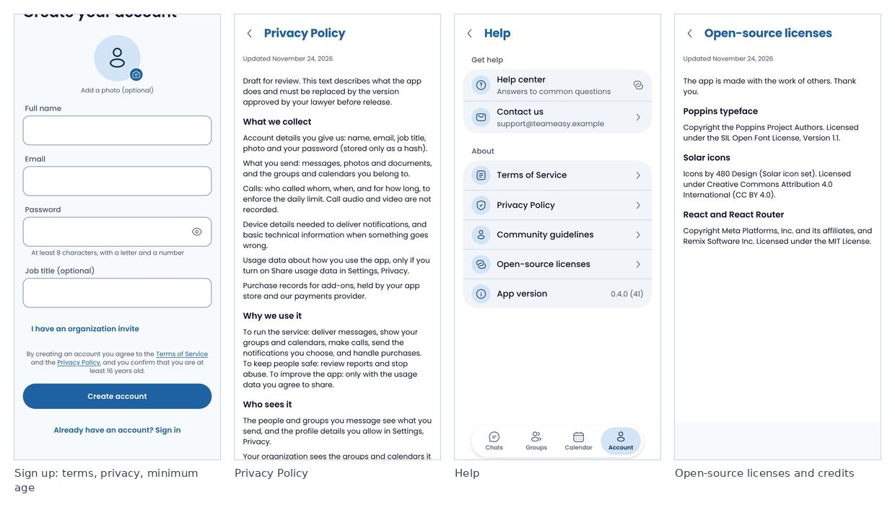
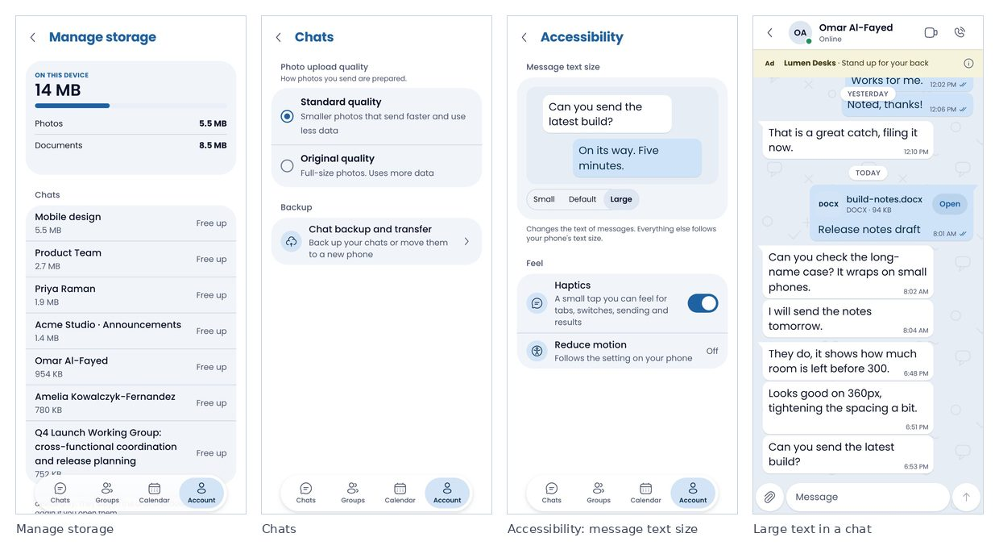
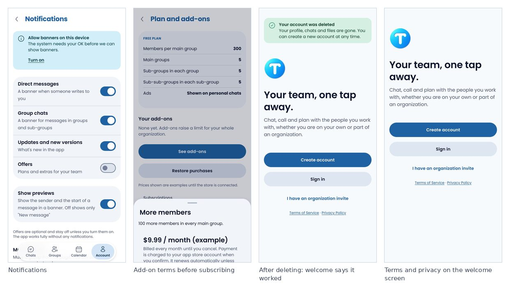

# Settings, safety and store compliance: mobile build guide

**Who this is for:** the engineers building the production phone app. It describes the settings area of the app, in plain language, with screenshots: every page, what people can do, the rules behind it, the states, and the build phases. It contains no code.

**Mobile only.** Everything here is about the phone app.

**What it is based on:** a working reference prototype (a phone app built as a web app, on fake data) that the designer finished. The screenshots come from it. The production app should look and behave the same way. Where the prototype fakes something, this guide says what the real version must do.

**Why this area exists:** neither Apple's App Store nor Google Play approves a messaging app without several of these pages: deleting your account inside the app, reporting and blocking people, a privacy policy and terms inside the app, clear subscription terms, and consent for ads and tracking. They are built like the settings of WhatsApp and the iPhone. The file `COMPLIANCE.md` in the same folder maps every store rule to the screen that meets it.

**Contents:** 1 The settings home · 2 Your account and deleting it · 3 Privacy and consent · 4 Report and block · 5 Legal pages and sign-up consent · 6 Storage and data, Chats, Accessibility, Notifications, Help · 7 Subscription terms · 8 What each store requires · 9 Build phases · 10 What is still missing · 11 Open questions · 12 Acceptance checklist

**Run the prototype:** `npm install`, `npm run dev`, open the address on a phone (or a window narrowed to phone width). Sign in with `layla@acme.co` and the password `longpass1`. To switch between fake states (empty, error, slow, offline) open any page once with `?review` added to the address.

---

## 1. The settings home

The **Account** tab is the settings home. From top to bottom:

1. **Profile card:** photo, name and job title. Tapping it opens Edit profile (name, email, job title, photo).
2. **Chat as:** only for people in an organization. Myself or the organization; it separates the two identities' chats and groups.
3. **Settings rows**, each with a round icon, a title and one line of description, like WhatsApp:
   - **Your account:** email, password, your data
   - **Privacy:** who sees you, blocked people, ads
   - **Chats:** media quality, backup, transfer
   - **Notifications:** messages, groups, updates
   - **Storage and data:** downloads, storage, retention
   - **Calls:** calling time and recent calls
   - **Accessibility:** text size, haptics, motion
4. **Plan and add-ons**, **Invite a friend** (opens the phone's share sheet, or copies a link if there is none) and **Add to home screen** (only until installed).
5. **Help** and **What's new.**
6. **Sign out**, and the app version at the very bottom.

**Rules for every settings page**
- Pushed pages slide in from the right with a Back arrow at the top left. Rows are at least 56 px tall and give instant press feedback.
- A row shows a chevron when it opens another page, an outward link icon when it leaves the app, a grey value when it shows the current choice, or a switch when it is an on/off setting. Tapping a switch row's text does nothing; only the switch changes it.
- Choices that have a few options open a **sheet** with radio rows. Choosing saves at once and closes it. There is no Save button except when editing profile.
- Every page has all its states: loading (skeleton), error with Try again, offline banner, and a success confirmation where something was saved or sent.
- Settings that live on the server (privacy audiences, password, data requests) can fail, so they show an error banner and roll back the switch or choice. Settings that only affect this phone (text size, haptics, previews, upload quality) apply immediately and are kept on the device.

---

## 2. Your account and deleting it

**What people do:** change their password, ask for a copy of their data, delete their account.

**Your account page**
- **Email:** shows the address; tapping opens Edit profile.
- **Change password:** a sheet with Current password, New password (at least 8 characters, a letter and a number) and Repeat new password. A wrong current password shows an error on that field ("That isn't your current password"). A password that is not strong enough or does not match shows the reason under the field. Success shows a tick and "Use your new password the next time you sign in."
- **Request your data:** a sheet explaining what is in the copy (profile, messages and files you sent, groups and calendars, settings) and that it is emailed within 7 days. Tapping Request a copy confirms with the date it will arrive. Afterwards the row reads "Requested. We'll email it by (date)" and a second request is not needed. Only the signed-in person can ask, and only their own data is included.
- **Delete account:** opens the delete page below.

**Delete account page** (a full page, not a pop-up)
- A red notice: "This can't be undone. Your account is deleted straight away, and so is what it holds."
- **What happens:** your profile, photo and settings are deleted; the chats you started and the files you sent are deleted for you; messages you sent in group chats stay for the group but no longer show your name or photo; you leave every group and organization; only the records the law requires (such as purchase records) are kept, and are deleted when the law allows.
- **Active add-ons:** if the person has any, an amber notice: "Deleting your account does not cancel add-ons billed by the App Store (or Google Play). Cancel them there so you are not charged again", with a Manage subscriptions link that opens the store's subscription page.
- **Password again:** a field "Enter your password to confirm". Empty shows "Enter your password"; a wrong password shows "That password isn't right" and nothing is deleted.
- A red **Delete my account** button and a **Keep my account** button.
- A footnote with a **web address** where someone who no longer has the app can ask for deletion (Google Play requires one).
- After a successful deletion the person is signed out and the welcome screen shows a green notice, "Your account was deleted. Your profile, chats and files are gone. You can create a new account at any time."

**Rules:** deletion must really remove the account and its data on the server, in every system, not just switch it off or hide it. Both stores check this. What is kept for legal reasons must be stated in the privacy policy. What happens to messages in groups and to an organization's groups is a decision to confirm (section 11).

---

## 3. Privacy and consent

**Who can see my info.** Three rows, each with the current choice on the right: **Online status**, **Profile photo**, **Job title.** Each opens a sheet with **Everyone** (anyone using the app), **My contacts** (people you chat with or share a group with) and **Nobody** (only you). A footnote says people you block never see any of it.

**Groups.** **Who can add me to groups:** Everyone or My contacts.

**Safety.**
- **Blocked contacts:** shows how many people are blocked and opens the list (section 4).
- **App permissions:** opens a list of the permissions the app uses, with their status.

**Ads and data.** Two switches, both **off until the person turns them on**, with the line "Both are off until you turn them on. You can change them at any time."
- **Personalized ads:** "On the free plan, ads can fit you better." Turning it on does **not** turn it on straight away. A sheet first explains what tracking means ("The free plan shows ads. If you allow it, they can be based on how you use this app and other apps and websites. Paid add-ons remove ads."). Choosing Continue then triggers the system's own tracking question on iPhone. If the system refuses, the sheet explains how to change it in the phone's settings and the switch stays off. Not now leaves it off. Turning it off is immediate.
- **Share usage data:** "Helps us fix problems and improve the app." Nothing about how the app is used is recorded until this is on.

**App permissions page.** Photos, Microphone, Camera and Notifications, each with a status: **Allowed**, **Not allowed** or **Not asked yet.** Tapping one opens a short sheet:
- **Why we ask:** photos, "to send pictures from your library and to choose a profile photo"; microphone, "so people can hear you on calls, nothing is recorded"; camera, "to show your video on video calls"; notifications, "to tell you about new messages and calls when the app is closed".
- **Right now:** the status.
- If it has never been asked, an **Allow** button starts our usual explanation and the system request. If it was refused, the sheet says where to change it on that phone (iPhone: Settings, then this app; Android: Settings, Apps, this app, Permissions). The system owns the answer; this page only shows it.

**Rules**
- Consent is stored with the account and starts every sensitive feature only after yes. Analytics and ad software must not start before consent.
- The privacy audiences must be enforced by the server on what other people see, never only on the phone.
- If the app does not track people at all, the tracking explanation and the iPhone question can be removed (section 11).

---

## 4. Report and block

Required by both stores for any app where people send each other content.

**Where Report is**
- On any message from someone else: long press, then Report (it sits in the same menu as Copy).
- On a person: open their info from the name at the top of a chat, then Report.
- On a group: the group's info page, Report group.

**The report sheet**
1. A line: "Your report is private."
2. **Reason**, choose one: Spam; Harassment or bullying; Hate speech; Violence or threats; Sexual content; Scam or fraud; Something else.
3. **Add details (optional).**
4. **Also block (name)** switch, for reports about a person or a message. Not shown for groups.
5. **Send report** (disabled until a reason is chosen). It shows a spinner; a failure shows an error with Try again and keeps what was typed.
6. The confirmation: "Thank you. We look at every report within 24 hours and take action if the rules were broken. (Name) isn't told who reported." and, if blocked, "(Name) is now blocked."

**Block**
- In contact info (direct chats only): **Block (name)** asks first: "(Name) won't be able to message or call you. They aren't told that you blocked them. You can unblock (name) at any time in Privacy, Blocked contacts." Then Block or Cancel.
- In a blocked chat the message field is replaced by "You blocked (name). Unblock to send messages or call." with an **Unblock** button, and the call buttons in the top bar stop working. The contact info now offers **Unblock (name)** instead of Block.
- **Privacy, Blocked contacts** lists everyone blocked with their job title and an **Unblock** button, newest first. Empty state: "No blocked contacts. People you block can't message or call you, and they aren't told."

**Rules**
- Blocking is enforced by the server: a blocked person cannot send messages or place calls to you, and is never told.
- Messages that were already sent stay in the chat.
- A report goes to a queue that moderators work through; the 24-hour promise must be staffed (section 10).

---

## 5. Legal pages and sign-up consent

**The four pages**
- **Terms of Service**
- **Privacy Policy:** what is collected, why, who sees it, ads, how long it is kept, the person's choices and rights, children, contact.
- **Community guidelines:** what is not allowed, how to report and block, what we do (look at every report within 24 hours).
- **Open-source licenses:** credits Poppins (SIL Open Font License) and the Solar icons by 480 Design (Creative Commons Attribution 4.0, which **requires** the credit), plus the code libraries used.

Each shows its title, an "Updated (date)" line and plain sections. They open **without an account**, because people agree to them before they have one; Back returns to where the person came from.

**Where they are linked**
- **Sign up:** above Create account: "By creating an account you agree to the Terms of Service and the Privacy Policy, and you confirm that you are at least 16 years old." Both names are links.
- **Welcome screen:** "Terms of Service · Privacy Policy" at the bottom.
- **Help:** Terms of Service, Privacy Policy, Community guidelines, Open-source licenses.
- **Privacy:** a Privacy policy row.
- **Subscribing** and the **Plan screen** (section 7).

**Help page:** Help center (opens outside the app), **Contact us** (opens the phone's mail app to the support address, with the app version and device details filled in below the message), the four legal pages, and the app version and build.

**Rules**
- The text in the prototype is a **draft** that describes what the app really does. Replace it with the text approved by your lawyer before release, and use the same privacy policy address in the store listings.
- The minimum age (built as 16) is stated at sign-up and in the terms. If an account under that age is found, it is deleted.

---

## 6. Storage and data, Chats, Accessibility, Notifications, Help

**Storage and data**
- **Media auto-download:** Always, Wi-Fi only (the default) or Never. This is requirement MED-05.
- **Use less data for calls:** a switch; calls use lower quality on mobile data.
- **Manage storage:** shows the total on the device, split into photos and documents with a bar, then each chat with its size and **Free up.** Freeing up asks first and removes that chat's photos and documents from this phone only; messages stay and files download again if opened. Empty state: "Nothing stored."
- **Backup, transfer and deletion rules:** the page for backing up chats, moving them to a new phone with a 6-digit code (valid 10 minutes, single use), and the list of files that will be deleted soon (unopened files are deleted after 6 days, 15 for business accounts; archived groups after 90 days).

**Chats**
- **Photo upload quality:** Standard (smaller photos that send faster and use less data) or Original. The photo preview before sending says which is in use and where to change it.
- **Chat backup and transfer:** a link to the page above.

**Accessibility**
- **Message text size:** Small, Default, Large, with a live preview of two bubbles. It changes the text of every message in the app (about 14, 15 and 18 px). Everything else follows the phone's own text size.
- **Haptics:** a switch, on by default. When off, no haptic fires anywhere.
- **Reduce motion:** shows whether the phone's setting is on; it cannot be changed here.

**Notifications:** switches for direct messages, group chats, updates and **Offers** (off by default, with its own note: "Offers are optional and stay off unless you turn them on. The app works fully without any notifications."); **Show previews** (when off, a banner only says "New message"); the system permission is asked only after our explanation; muted groups; and **Reset notification settings.**

---

## 7. Subscription terms

Both stores check how subscriptions are described. In the app:
- **Before subscribing** (the confirm step of an add-on): the price and period; that payment is charged to the person's store account when they confirm; that it renews automatically unless auto-renew is turned off at least 24 hours before the end of the period; where to manage or cancel it; that after cancelling it runs to the end of the month paid for and nothing is deleted; and links to the Terms of Service and the Privacy Policy.
- **Plan and add-ons screen:** the current limits, the person's add-ons with their renewal date, **Restore purchases**, and a **Subscriptions** group with **Manage in App Store** (or **Google Play**), the Terms and the Privacy Policy, and the line "Deleting the app or your account does not cancel them."
- Prices come from the store exactly as it reports them. Only admins can buy; members see the same screens but cannot.

---

## 8. What each store requires

Rules change, so verify each against the store's own page before every submission: [App Review Guidelines](https://developer.apple.com/app-store/review/guidelines/), [Apple: account deletion](https://developer.apple.com/help/app-review/guideline-reference/5-1-1-account-deletion/), [Apple: subscriptions](https://developer.apple.com/app-store/subscriptions/), [Google Play: account deletion](https://support.google.com/googleplay/android-developer/answer/13327111), [Google Play: user generated content](https://support.google.com/googleplay/android-developer/answer/9876937), [Google Play: Data safety](https://support.google.com/googleplay/android-developer/answer/10787469).

| Requirement | Apple App Store | Google Play | Where in the app |
|---|---|---|---|
| **Delete account inside the app**, removing the account and its data | Required (5.1.1(v)); deactivating is not enough | Required, plus a web page for people without the app, entered in Play Console | Your account, Delete account |
| **Report and block** for user content, with prompt action | Required (1.2), plus filtering of objectionable content and contact details | Required for user content; blocking for direct messaging | Report on messages, people, groups; Block; Blocked contacts; Help, Contact us |
| **Privacy policy** in the app and the listing | Required | Required | Help; sign-up; welcome; Privacy |
| **Say what data is collected and why** | Privacy labels | Data safety form | The data map in `COMPLIANCE.md` |
| **Consent for tracking and personalized ads** | The system tracking question first, if the app tracks | Ads declared, clearly labeled | Privacy, Personalized ads; ads carry an "Ad" tag and a "Why you see this ad" sheet with Ad choices |
| **Subscriptions:** clear price and period, terms, restore, easy to cancel | Required (3.1.1, 3.1.2) | Play Billing, clear terms, easy cancel | Plan screen and the confirm step |
| **Push must not be required**, marketing only with opt-in | Required (4.5.4) | Runtime notification permission | Offers off by default; permission asked after our explanation |
| **Permissions** explained, and the app works if refused | Purpose strings; ask in context | Ask in context, declare in Play Console | Our sheet before each system prompt; App permissions page |
| **Age** | Age rating questionnaire | Target audience and content rating | Minimum age 16 at sign-up |

**What the app promises people (built):** consent first and off by default; control over who sees them; a copy of their data on request; deletion inside the app and on the web; a minimum age; credits for the open-source work used.

---

## 9. Build phases

Each phase ends with an exit check a person can try.

| Phase | What gets built | Exit check |
|---|---|---|
| K1 | Settings home; Your account (email, change password); Help; the four legal pages readable signed out; terms, privacy and minimum age at sign-up | Every legal page opens signed out; sign-up states terms, privacy and age |
| K2 | Delete account page (password again, what happens, subscription warning, web address); the web deletion page; Request your data | A deletion removes the account from every system; the web page works without the app |
| K3 | Report and block: message, person and group; block and unblock; Blocked contacts; blocked chat state; calls stop; blocking enforced by the server; a moderation queue | A blocked person cannot reach you; a report arrives in a queue someone answers within the promised time |
| K4 | Privacy: audiences, who can add me to groups, App permissions; consent for usage data and personalized ads (off by default); the tracking explanation | Nothing is collected or personalized before consent; the system tracking question only appears after our explanation |
| K5 | Storage and data; Chats (photo quality); Accessibility (text size, haptics); notification extras | Text size changes every message; choices survive restarts |
| K6 | Subscription terms and manage links on the Plan screen and the confirm step; restore | The wording matches the store's subscription text; Manage opens the store |

**Placeholders to replace with real services** (listed in `WIRING.md`): `settings.privacy`, `settings.password`, `settings.data-export`, `safety.report-block`, `legal.documents`, `legal.links`, `privacy.consent`, `data.storage`, and the existing `auth.delete-account` (now asks for the password again).

---

## 10. What is still missing before the stores will approve

1. **Filtering of objectionable content before it is posted.** Apple requires it. Not built. It needs server-side checks on text and images and a moderation queue.
2. **A moderation team** that answers reports within the 24 hours the app promises.
3. **Counsel-approved** terms, privacy policy and community guidelines to replace the draft text.
4. **Real web addresses** for support, help center, the web deletion page and the share link (placeholders now), and the deletion page itself built.
5. **Real deletion** across every system, with a retention statement that matches it.
6. **Consent wiring:** analytics and ad software started only after consent; the tracking question on iPhone.
7. **Store listing answers:** privacy labels, the Data safety form, age rating, subscription text, permission explanations, the ads declaration.
8. **Not built, needs a decision:** app lock with Face ID, two-step verification, disappearing messages, read receipts.

---

## 11. Open questions

| # | Question | Needed by |
|---|---|---|
| 1 | Content filtering: what is screened, with which tools, and who answers reports within 24 hours | Phase 2 |
| 2 | Minimum age (built as 16) and the answers to the store age-rating questions | Phase 1 |
| 3 | On deletion: what happens to messages in groups, to an organization's groups, and which records the law makes us keep | Phase 1 |
| 4 | Counsel-approved legal text | Phase 1 |
| 5 | The real support email, help center and web deletion page addresses, and who owns the deletion page | Phase 1 |
| 6 | Whether personalized ads and tracking are used at all (if not, the tracking explanation and the iPhone question can be dropped) | Phase 3 |
| 7 | Whether to add app lock with Face ID and two-step verification | Phase 3 |

---

## 12. Acceptance checklist

For each page in a phase, check against the screenshots:

- [ ] Looks the same on 360, 390 and 440 px wide phones, with and without the notch and home bar.
- [ ] Has loading, error with Try again, offline and success states; server-held settings roll back when saving fails.
- [ ] Every row has an accessible name; touch targets are at least 48 px; contrast meets AA.
- [ ] Every gesture has a visible alternative (sheets close from a tap outside, chats have Back).
- [ ] Deleting an account needs the password again and really removes the account and its data.
- [ ] A report needs a reason, says it is private and gives the promised review time; a blocked person cannot message or call.
- [ ] Usage data and personalized ads are off until turned on; nothing is collected before consent.
- [ ] Terms and privacy open signed out and are linked at sign-up, on the welcome screen, in Help and before subscribing.
- [ ] Subscription wording states price, period, auto-renew, how to cancel; Restore purchases and Manage in the store work.
- [ ] The Solar icons and Poppins are credited on the licenses page.
- [ ] The matching placeholder is replaced by the real service and its row in `WIRING.md` is marked done.
